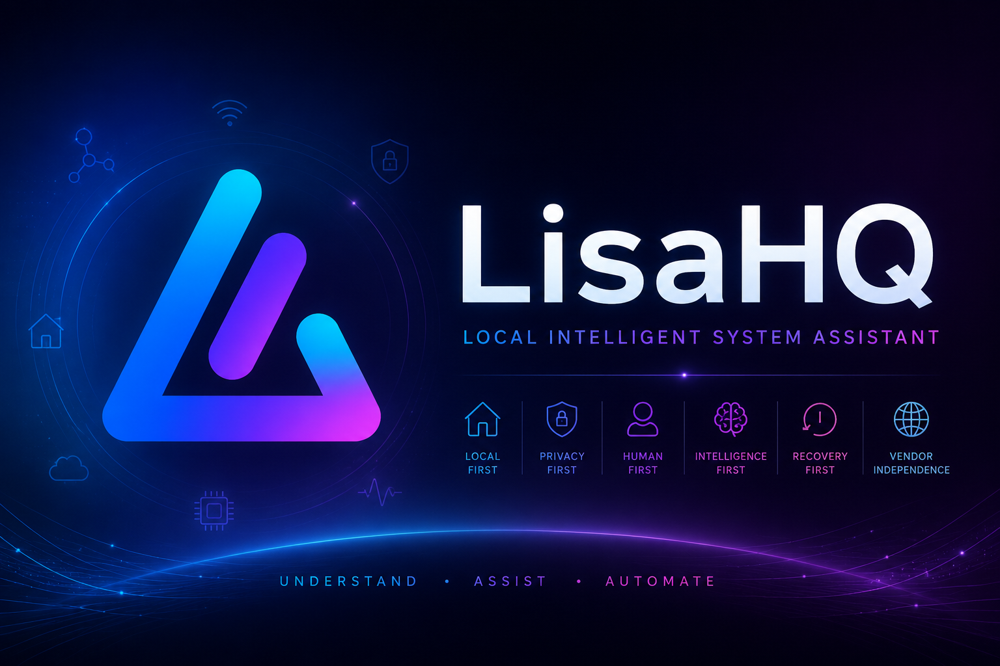

<!--
  Proposed replacement for profile/README.md (LisaHQ org profile).
  Target path in the repository: profile/README.md
  This English version is the source of truth. The Vietnamese translation is profile/README.vi.md;
  change this file first, then update the translation to match.
-->



# 🍃 LISA — Local Intelligent System Assistant

> Building an AI that understands people, not commands.

🧠 Reasoning • 👁️ Vision • 🗣️ Voice • 🏠 Smart Home  
🔒 Privacy First • ⚡ Local First • ♻️ Recovery First

_🚧 Early development project_

LISA is a local-first AI ecosystem designed to become a truly intelligent digital caretaker.
The goal is not to automate a house.
The goal is to create an AI that feels natural to live with.

_English · [Tiếng Việt](https://github.com/LisaHQ/.github/blob/main/profile/README.vi.md)_

## 💬 The difference

A traditional assistant waits for a wake word and an exact command:

```text
User:      <wake word>, set the living room speaker volume to 20 percent.
Assistant: OK, the living room speaker volume is now 20 percent.
User:      <wake word>, turn on the living room sofa light at 35 percent.
Assistant: OK, the living room sofa light is on at 35 percent.
User:      <wake word>, change the living room sofa light to warm white.
Assistant: OK, the living room sofa light is now warm white.
```

LISA aims for this:

```text
(The user is reading a book in the living room.)
User: Could you turn the music down a little?
Lisa: Sure. I lowered it to 20 percent. Is that okay now?
User: That's good.
Lisa: It looks a little dark. Would you like me to turn on the lights?
User: Yes, but just enough, don't turn them all on.
Lisa: I'll turn on the sofa light at 35 percent, warm white.
```

No wake words. No command syntax. No device names to remember.

## 🤔 Why LISA exists

Today's voice assistants are very capable, yet talking to them still feels unnatural. Users have to remember commands, wake words, app names, and automation rules.

People do not communicate this way. When you tell someone _"Could you turn it down a little?"_, they understand what "it" refers to, where the sound is coming from, who is speaking, and what level is appropriate.

LISA exists to close that gap: machines should learn to understand people, instead of people learning how to talk to machines.

## 🧿 What LISA is (and is not)

**LISA (Local Intelligent System Assistant)** is an open, local-first AI ecosystem whose long-term goal is to understand people, environments, context, and intent.

LISA is **not** a chatbot, a voice assistant, a home automation platform, a collection of scripts, or a cloud service.

LISA aims to be capable of:

- Understanding natural speech and context
- Recognizing presence, habits, and environments
- Coordinating devices
- Learning safely over time
- Assisting proactively
- Remaining under the owner's control

```text
Traditional automation:   IF motion detected THEN turn on light
Voice assistants:         User → Command → Action
LISA:                     Environment → Context → Understanding → Reasoning → Decision → Action
```

## 🏗️ How it fits together

```text
 People ── voice · presence ──►   LISA Voice              LISA Vision
                                  Conversation            Perception
                                       └───────────┬───────────┘
                                                   ▼
                                              LISA Brain
                               Reasoning · Context · Memory · Decisions
                                                   │
                      ┌────────────────────────────┴────────────────────┐
                      ▼                                                 ▼
            Smart home ecosystems                                   LISA Edge
      (Homey · Home Assistant · others)           MQTT · Thread · Matter · VPN · backup
         one or many, all replaceable
                      │                                                 │
                      └───────────────────►  Devices  ◄─────────────────┘

 ════════════════════════════════  LISA Core  ═════════════════════════════════
      Shared platform under every component: APIs · events · security
```

LISA Core is the band at the bottom, not a step in the flow: it is the set of contracts the other components share, so that each one can be replaced on its own.

### 🏠 Smart home: not tied to any ecosystem

LISA is not built on top of Homey, Home Assistant, or any other smart home platform.

- **A platform is only a bridge.** A smart home ecosystem sits between LISA and the devices. LISA owns the understanding and the decisions; the ecosystem only carries device state in and actions out.
- **Any ecosystem can be plugged in,** as long as it offers an API or a common protocol to work with (for example Matter or IFTTT).
- **Several ecosystems can be used at the same time.** One home can combine more than one, and LISA treats them as a single environment.
- **Every bridge is replaceable.** Swapping or removing an ecosystem must not require changing LISA itself.

The reference setup used during development is a Homey Pro, with Home Assistant covering the devices Homey does not support. That is simply what the author's home runs. It is an example, not a requirement: another home may run Home Assistant only, or something else entirely.

## 🟢 Status

| Component | Role | Status | Repository |
| --- | --- | --- | --- |
| 📡 LISA Edge v0 | The first version of LISA Edge; installs on Ubuntu Server and Debian | Archived, kept for reference | [lisa-edge-v0-archived](https://github.com/LisaHQ/lisa-edge-v0-archived) |
| 📡 **LISA Edge** | Local infrastructure: MQTT, Thread and Matter, Zigbee, VPN, monitoring, backup, and recovery | Being rebuilt | lisa-edge (not public yet) |
| 🧠 **LISA Brain** | Reasoning, context, memory, and device coordination | In design | Not published |
| ⚙️ **LISA Core** | Shared contracts between components: events, APIs, and security model | Planned | Not published |
| 🗣️ **LISA Voice** | Speech recognition, speech synthesis, and dialogue | Planned | Not published |
| 👁️ **LISA Vision** | Presence and environment awareness | Planned | Not published |

<!-- VERIFIED 2026-11-23: lisa-edge is a private repository with no commits yet, so it is listed without a link; a public visitor would get a 404. Add the link once it is public. -->

Tools built alongside LISA:

| Project | What it does | Status | Repository |
| --- | --- | --- | --- |
| Ingat | Installs, updates, and backs up Docker Compose apps on one machine, with a checked backup before every risky change | Early; v0.1.0 is a draft | [ingat](https://github.com/LisaHQ/ingat) |
| lisa-skills | Reusable AI agent skills for everyday workflows | Available | [lisa-skills](https://github.com/LisaHQ/lisa-skills) |

## 🚀 Start here

The new LISA Edge is not published yet. Until it is, the best way in is the archived first version:

- Read the [ecosystem architecture](https://github.com/LisaHQ/lisa-edge-v0-archived/blob/main/docs/architecture/01-lisa-ecosystem.md).
- To try it on a machine, follow the [fresh install steps](https://github.com/LisaHQ/lisa-edge-v0-archived#fastest-fresh-install). Note that this version is no longer maintained.

## 💎 Core principles

- **Local First:** critical functions keep working without Internet access. Core intelligence does not depend on a cloud provider.
- **Privacy First:** your environment, your devices, your data, your control. Sensitive information stays local whenever practical.
- **Human First:** machines learn to communicate with people, not the other way around.
- **Intelligence First:** automation is a feature. Understanding, context, and reasoning are the objective.
- **Recovery First:** `Recovery > High Availability > Complexity`. Systems are easy to restore, rebuild, migrate, and maintain.
- **Vendor Independence:** no layer depends on one hardware vendor, smart home ecosystem, cloud provider, or AI model. LISA is never locked to one of them.

## 🚩 Roadmap

| Phase | Focus | State |
| --- | --- | --- |
| 1 | Infrastructure foundation (LISA Edge rebuild), groundwork for LISA Brain, first smart home ecosystem connected through a replaceable bridge | In progress |
| 2 | More ecosystems side by side, voice interaction, multi-turn conversation, long-term memory, context awareness, habit learning | Planned |
| 3 | Vision-assisted understanding, presence-aware reasoning, proactive assistance | Planned |
| 4 | Multi-modal intelligence, cross-environment reasoning, conversation without wake words | Planned |

## 🎯 Ultimate goal

An assistant that understands people rather than commands, and adapts to humans rather than forcing humans to adapt to technology.

Private. Local. Reliable. Recoverable. Entirely under the owner's control.

## 🔑 License

This repository is licensed under **Apache 2.0**; see [LICENSE](https://github.com/LisaHQ/.github/blob/main/LICENSE).  
LISA is intended to become a commercial product, so other LISA repositories, services, models, datasets, or components may use different licenses.

**Trademark notice:** LISA, LisaHQ, and all associated names, logos, icons, and branding assets are the property of LisaHQ. The Apache 2.0 license applies only to the source code and documentation in this repository. It does not grant the right to use the LISA or LisaHQ names or branding in derivative projects, products, services, or commercial offerings, which may require explicit permission from LisaHQ.

Copyright (c) 2026 **[LisaHQ](https://lisahq.io)**
