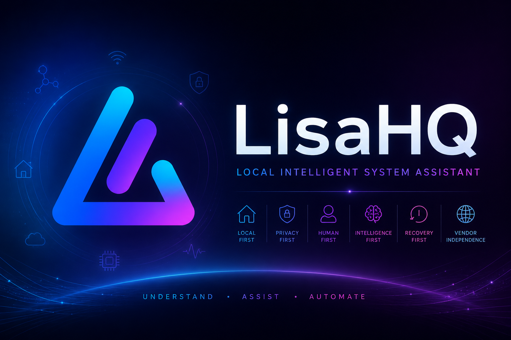

<!--
  Proposed Vietnamese translation of the LisaHQ org profile README.
  Target path in the repository: profile/README.vi.md
  The English version (profile/README.md) is the source of truth; update this file only to follow it.
-->



# 🍃 LISA — Local Intelligent System Assistant

> Xây dựng một AI hiểu con người, không phải hiểu câu lệnh.

🧠 Suy luận • 👁️ Thị giác • 🗣️ Giọng nói • 🏠 Nhà thông minh  
🔒 Riêng tư trước • ⚡ Chạy cục bộ trước • ♻️ Khôi phục được trước

_🚧 Dự án đang ở giai đoạn phát triển sớm_

LISA là một hệ sinh thái AI chạy cục bộ (local-first), hướng tới trở thành một "người quản gia số" thật sự.
Mục tiêu không phải là tự động hóa một ngôi nhà.
Mục tiêu là tạo ra một AI mà ta thấy tự nhiên khi sống cùng.

_[English](https://github.com/LisaHQ/.github/blob/main/profile/README.md) · Tiếng Việt_

_Bản tiếng Anh là bản gốc. Nếu hai bản khác nhau, bản tiếng Anh là bản đúng._

## 💬 Sự khác biệt

Trợ lý truyền thống chờ từ đánh thức và một câu lệnh chính xác:

```text
Người dùng: <từ đánh thức>, đặt âm lượng loa phòng khách 20 phần trăm.
Trợ lý:     OK, âm lượng loa phòng khách đã là 20 phần trăm.
Người dùng: <từ đánh thức>, bật đèn sofa phòng khách 35 phần trăm.
Trợ lý:     OK, đã bật đèn sofa phòng khách 35 phần trăm.
Người dùng: <từ đánh thức>, đổi màu đèn sofa phòng khách sang trắng ấm.
Trợ lý:     OK, đã đổi màu đèn sofa phòng khách sang trắng ấm.
```

LISA hướng tới điều này:

```text
(Người dùng đang đọc sách ở phòng khách.)
Người dùng: Vặn nhạc nhỏ xuống chút được không?
Lisa:       Được ạ. Mình giảm xuống 20 phần trăm rồi, vậy đã ổn chưa?
Người dùng: Ổn rồi.
Lisa:       Phòng hơi tối, bạn có muốn mình bật đèn không?
Người dùng: Ừ, nhưng vừa đủ thôi, đừng bật hết.
Lisa:       Mình bật đèn sofa 35 phần trăm, ánh sáng trắng ấm nhé.
```

Không từ đánh thức. Không cú pháp lệnh. Không cần nhớ tên thiết bị.

## 🤔 Vì sao có LISA?

Trợ lý giọng nói ngày nay đã rất mạnh, nhưng nói chuyện với chúng vẫn chưa tự nhiên. Người dùng phải nhớ câu lệnh, từ đánh thức, tên ứng dụng và các luật tự động hóa.

Con người không giao tiếp như vậy. Khi bạn nói với một người khác _"Vặn nhỏ xuống chút"_, họ tự hiểu "cái gì" cần vặn, âm thanh đến từ đâu, ai đang nói và mức nào là vừa.

LISA tồn tại để lấp khoảng cách đó: máy nên học cách hiểu người, chứ không bắt người học cách nói với máy.

## 🧿 LISA là gì (và không là gì)

**LISA (Local Intelligent System Assistant)** là một hệ sinh thái AI mở, chạy cục bộ, có mục tiêu dài hạn là hiểu con người, môi trường, ngữ cảnh và ý định.

LISA **không phải** là một chatbot, một trợ lý giọng nói, một nền tảng nhà thông minh, một mớ script hay một dịch vụ cloud.

LISA hướng tới khả năng:

- Hiểu lời nói tự nhiên và ngữ cảnh
- Nhận biết sự hiện diện, thói quen và môi trường
- Điều phối thiết bị
- Học dần một cách an toàn
- Chủ động hỗ trợ
- Luôn nằm dưới quyền kiểm soát của chủ nhà

```text
Tự động hóa truyền thống:   IF có chuyển động THEN bật đèn
Trợ lý giọng nói:            Người dùng → Câu lệnh → Hành động
LISA:                        Môi trường → Ngữ cảnh → Hiểu → Suy luận → Quyết định → Hành động
```

## 🏗️ Các phần ghép với nhau thế nào

```text
 Người ── giọng nói · hiện diện ─►  LISA Voice              LISA Vision
                                    Hội thoại               Nhận thức
                                       └───────────┬───────────┘
                                                   ▼
                                              LISA Brain
                               Suy luận · Ngữ cảnh · Trí nhớ · Quyết định
                                                   │
                      ┌────────────────────────────┴────────────────────┐
                      ▼                                                 ▼
         Hệ sinh thái nhà thông minh                                LISA Edge
       (Homey · Home Assistant · khác)            MQTT · Thread · Matter · VPN · sao lưu
        một hoặc nhiều, đều thay được
                      │                                                 │
                      └───────────────────►  Thiết bị  ◄────────────────┘

 ════════════════════════════════  LISA Core  ═════════════════════════════════
      Nền tảng dùng chung dưới mọi thành phần: API · sự kiện · bảo mật
```

LISA Core là dải ở dưới cùng, không phải một bước trong luồng: đó là bộ hợp đồng mà các thành phần khác dùng chung, để mỗi thành phần có thể được thay thế riêng.

### 🏠 Nhà thông minh: không gắn với hệ sinh thái nào

LISA không được xây trên Homey, Home Assistant hay bất kỳ nền tảng nhà thông minh nào khác.

- **Nền tảng chỉ là cầu nối.** Một hệ sinh thái nhà thông minh đứng giữa LISA và thiết bị. LISA giữ phần hiểu và ra quyết định; hệ sinh thái chỉ đưa trạng thái thiết bị vào và đưa hành động ra.
- **Hệ sinh thái nào cũng cắm vào được,** miễn là nó cung cấp API hoặc một giao thức chung để làm việc (ví dụ Matter hoặc IFTTT).
- **Dùng được nhiều hệ sinh thái cùng lúc.** Một ngôi nhà có thể kết hợp nhiều hệ sinh thái, và LISA xem chúng như một môi trường duy nhất.
- **Cầu nối nào cũng thay được.** Đổi hoặc bỏ một hệ sinh thái không được buộc phải sửa chính LISA.

Cấu hình tham chiếu trong quá trình phát triển là Homey Pro 2023, kèm Home Assistant cho những thiết bị Homey chưa hỗ trợ. Đó đơn giản là những gì nhà của tác giả đang dùng. Đây là ví dụ, không phải yêu cầu: nhà khác có thể chỉ dùng Home Assistant, hoặc một thứ hoàn toàn khác.

## 🟢 Tình trạng

| Thành phần | Vai trò | Tình trạng | Repository |
| --- | --- | --- | --- |
| 📡 LISA Edge v0 | Phiên bản đầu tiên của LISA Edge; cài được trên Ubuntu Server và Debian | Đã lưu trữ, giữ để tham khảo | [lisa-edge-v0-archived](https://github.com/LisaHQ/lisa-edge-v0-archived) |
| 📡 **LISA Edge** | Hạ tầng cục bộ: MQTT, Thread và Matter, Zigbee, VPN, giám sát, sao lưu và khôi phục | Đang xây dựng lại | lisa-edge (chưa công khai) |
| 🧠 **LISA Brain** | Suy luận, ngữ cảnh, trí nhớ và điều phối thiết bị | Đang thiết kế | Chưa công bố |
| ⚙️ **LISA Core** | Hợp đồng dùng chung giữa các thành phần: sự kiện, API và mô hình bảo mật | Kế hoạch | Chưa công bố |
| 🗣️ **LISA Voice** | Nhận dạng giọng nói, tổng hợp giọng nói và hội thoại | Kế hoạch | Chưa công bố |
| 👁️ **LISA Vision** | Nhận biết sự hiện diện và môi trường | Kế hoạch | Chưa công bố |

<!-- VERIFIED 2026-11-23: lisa-edge is a private repository with no commits yet, so it is listed without a link; a public visitor would get a 404. Add the link once it is public. -->

Các công cụ được xây cùng LISA:

| Dự án | Làm gì | Tình trạng | Repository |
| --- | --- | --- | --- |
| Ingat | Cài đặt, cập nhật và sao lưu các ứng dụng Docker Compose trên một máy, luôn có bản sao lưu đã kiểm tra trước mỗi thay đổi rủi ro | Giai đoạn đầu; v0.1.0 là bản nháp | [ingat](https://github.com/LisaHQ/ingat) |
| lisa-skills | Các skill dùng lại được cho AI agent trong công việc hằng ngày | Đã dùng được | [lisa-skills](https://github.com/LisaHQ/lisa-skills) |

## 🚀 Bắt đầu từ đâu

LISA Edge bản mới chưa được công bố. Trong lúc chờ, cách tốt nhất để tìm hiểu là phiên bản đầu tiên đã lưu trữ:

- Đọc [kiến trúc hệ sinh thái](https://github.com/LisaHQ/lisa-edge-v1/blob/main/docs/architecture/01-lisa-ecosystem.md).
- Muốn chạy thử trên máy, làm theo [các bước cài mới](https://github.com/LisaHQ/lisa-edge-v1#fastest-fresh-install). Lưu ý phiên bản này không còn được bảo trì.

## 💎 Nguyên tắc cốt lõi

- **Chạy cục bộ trước:** các chức năng quan trọng vẫn chạy khi mất Internet. Trí tuệ cốt lõi không phụ thuộc nhà cung cấp cloud.
- **Riêng tư trước:** môi trường của bạn, thiết bị của bạn, dữ liệu của bạn, quyền kiểm soát của bạn. Thông tin nhạy cảm ở lại cục bộ bất cứ khi nào làm được.
- **Con người trước:** máy học cách giao tiếp với người, không phải ngược lại.
- **Trí tuệ trước:** tự động hóa chỉ là tính năng. Hiểu, ngữ cảnh và suy luận mới là mục tiêu.
- **Khôi phục trước:** `Khôi phục > Sẵn sàng cao > Phức tạp`. Hệ thống dễ khôi phục, dựng lại, di chuyển và bảo trì.
- **Không phụ thuộc nhà cung cấp:** không lớp nào phụ thuộc vào một hãng phần cứng, một hệ sinh thái nhà thông minh, một nhà cung cấp cloud hay một mô hình AI. LISA không bao giờ bị khóa vào một bên nào.

## 🚩 Lộ trình

| Giai đoạn | Trọng tâm | Trạng thái |
| --- | --- | --- |
| 1 | Nền hạ tầng (xây dựng lại LISA Edge), đặt nền móng LISA Brain, kết nối hệ sinh thái nhà thông minh đầu tiên qua một cầu nối thay thế được | Đang thực hiện |
| 2 | Nhiều hệ sinh thái song song, tương tác giọng nói, hội thoại nhiều lượt, trí nhớ dài hạn, nhận biết ngữ cảnh, học thói quen | Kế hoạch |
| 3 | Hiểu nhờ thị giác, suy luận theo sự hiện diện, hỗ trợ chủ động | Kế hoạch |
| 4 | Trí tuệ đa phương thức, suy luận xuyên môi trường, hội thoại không cần từ đánh thức | Kế hoạch |

## 🎯 Mục tiêu cuối cùng

Một trợ lý hiểu con người thay vì câu lệnh, thích nghi với con người thay vì bắt con người thích nghi với công nghệ.

Riêng tư. Cục bộ. Đáng tin cậy. Khôi phục được. Hoàn toàn trong tay chủ nhà.

## 🔑 Giấy phép

Repository này dùng giấy phép **Apache 2.0**, xem [LICENSE](https://github.com/LisaHQ/.github/blob/main/LICENSE).  
LISA có định hướng thương mại, nên các repository, dịch vụ, mô hình, bộ dữ liệu hoặc thành phần khác của LISA có thể dùng giấy phép khác.

**Thương hiệu:** LISA, LisaHQ cùng tên gọi, logo, biểu tượng và nhận diện thương hiệu liên quan là tài sản của LisaHQ. Giấy phép Apache 2.0 chỉ áp dụng cho mã nguồn và tài liệu trong repository này, không cấp quyền dùng tên hay nhận diện thương hiệu LISA/LisaHQ cho dự án phái sinh, sản phẩm, dịch vụ hoặc mục đích thương mại; việc đó có thể cần sự cho phép rõ ràng từ LisaHQ.

Copyright (c) 2026 **[LisaHQ](https://lisahq.io)**
